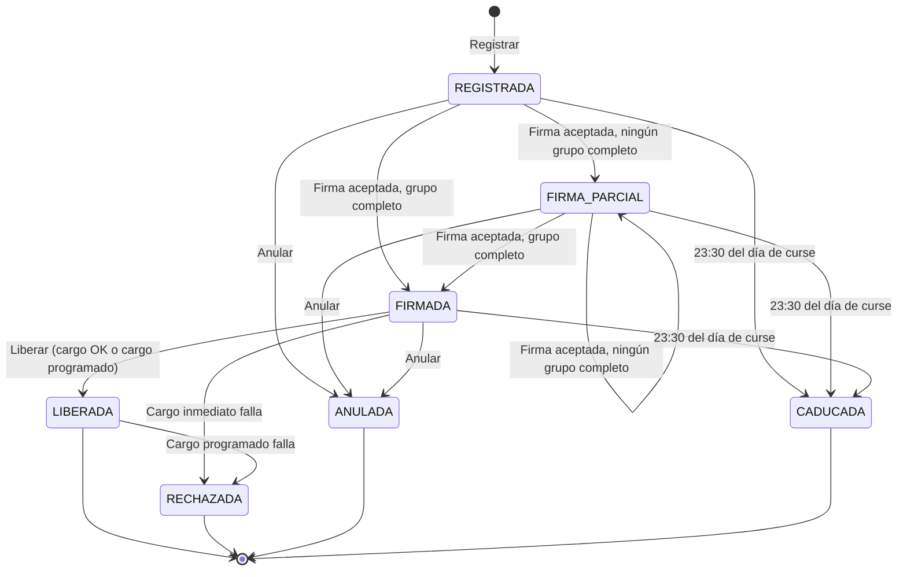
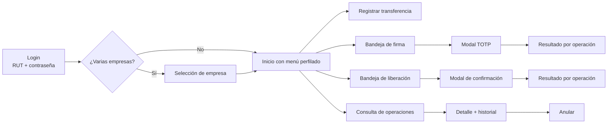
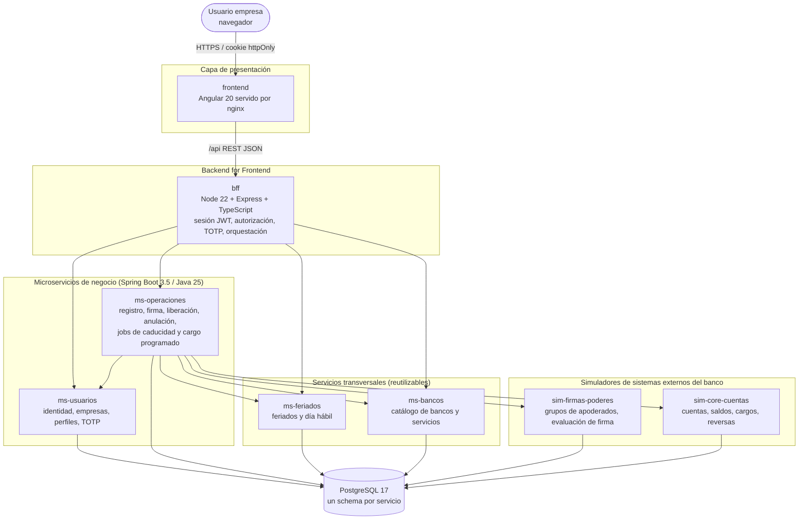
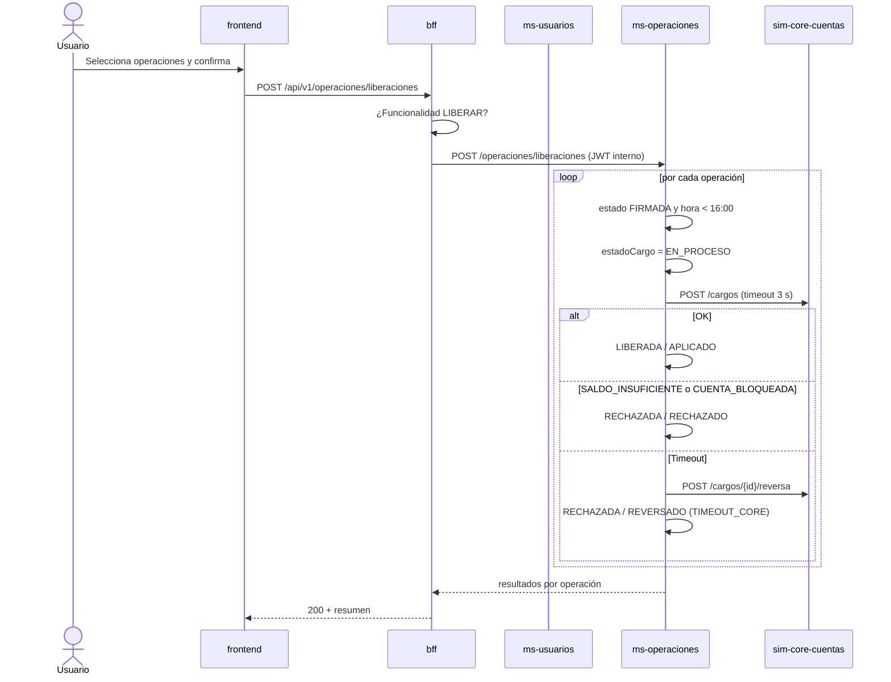
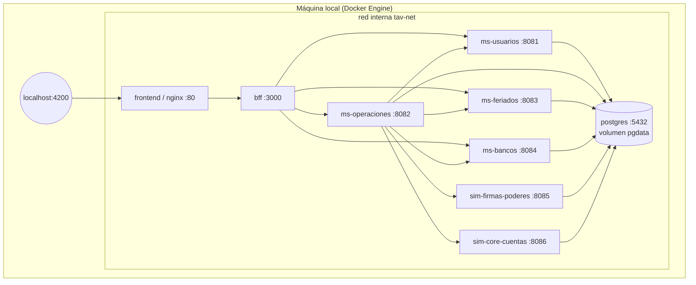
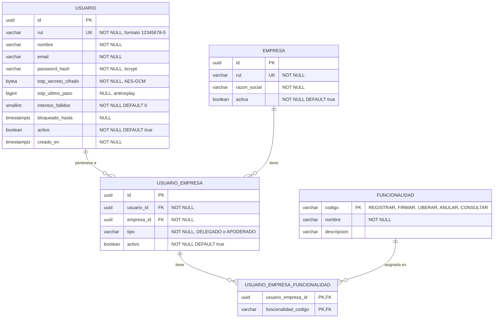
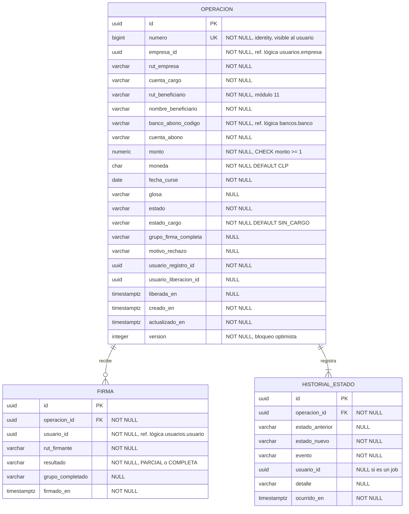
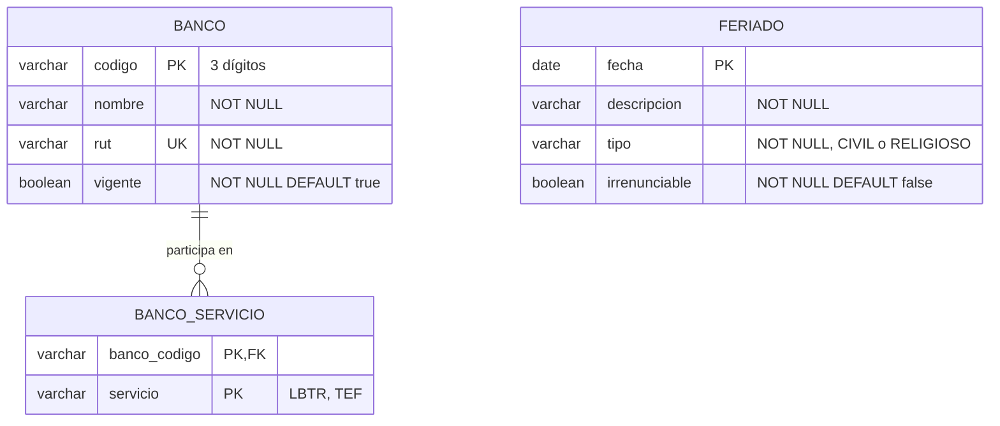
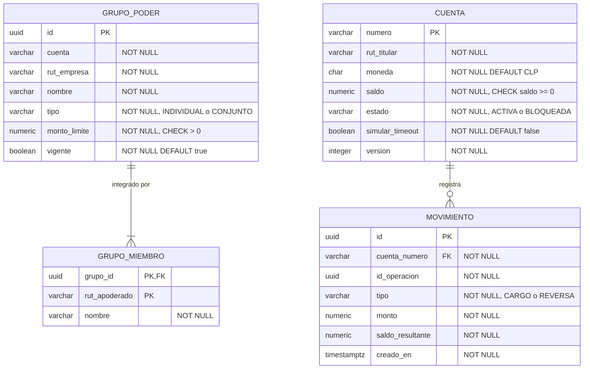
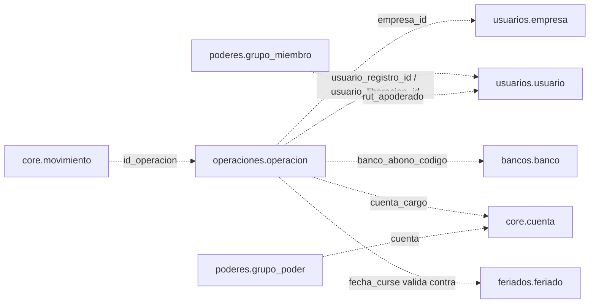

## Índice

0. [Ficha del proyecto](#0-ficha-del-proyecto)
1. [Descripción general del producto](#1-descripción-general-del-producto)
2. [Arquitectura del sistema](#2-arquitectura-del-sistema)
3. [Modelo de datos](#3-modelo-de-datos)
4. [Especificación de la API](#4-especificación-de-la-api)
5. [Historias de usuario](#5-historias-de-usuario)
6. [Tickets de trabajo](#6-tickets-de-trabajo)
7. [Pull requests](#7-pull-requests)

---

## 0. Ficha del proyecto

### **0.1. Tu nombre completo:**

Marco Bello

### **0.2. Nombre del proyecto:**

**Transferencias de Alto Valor** — Portal Empresas de **Banco Austral** (banco ficticio).

### **0.3. Descripción breve del proyecto:**

Simulación del flujo de **Transferencias de Fondos de Alto Valor liquidadas vía LBTR** (Liquidación Bruta en Tiempo Real) del portal de banca empresas de un banco chileno ficticio, Banco Austral. El producto cubre el ciclo completo que realiza una empresa: **registro** de la transferencia, **firma** por apoderados según sus poderes legales (individual o en lote, con firmas conjuntas e individuales) y **liberación** de la operación hasta el cargo en cuenta corriente. Incluye perfilamiento de usuarios por empresa, doble factor de autenticación (TOTP) para la firma y simuladores de los sistemas externos del banco (Firmas, Sociedades y Poderes y Core de cuentas corrientes). Todos los datos son inventados.

### **0.4. URL del proyecto:**

El proyecto se ejecuta **solo en local** mediante Docker Compose. Una vez levantado (ver [1.4](#14-instrucciones-de-instalación)) queda disponible en:

- Portal: `http://localhost:4200`
- Token virtual (demo): `http://localhost:4200/token-virtual`

> Se adjuntará un video demostrativo del flujo completo en la etapa de desarrollo.

### 0.5. URL o archivo comprimido del repositorio

https://github.com/marco-bs-07/AI4Devs-finalproject

---

## 1. Descripción general del producto

### **1.1. Objetivo:**

**Propósito.** Permitir que las empresas clientes de Banco Austral envíen transferencias de alto valor a cuentas de otros bancos, liquidadas en tiempo real a través del sistema LBTR, con un esquema de **control dual** (quien registra no es necesariamente quien firma ni quien libera) que respete los **poderes legales** de los apoderados de cada empresa.

**Qué soluciona.**

- Las transferencias de alto valor tienen un riesgo operacional y de fraude alto. El banco debe garantizar que solo se cursen operaciones autorizadas por quienes tienen poderes suficientes, según la escritura de la sociedad (grupos de apoderados, firmas conjuntas o individuales y montos máximos por grupo).
- Las empresas necesitan **segregar funciones**: un administrativo (delegado) prepara las operaciones, los apoderados las autorizan y un usuario de tesorería las libera dentro del horario de corte.
- Se requiere trazabilidad completa de cada operación: quién la registró, quién firmó, quién liberó y por qué se rechazó o caducó.

**Para quién.**

| Usuario | Descripción |
|---|---|
| **Delegado** | Usuario de la empresa **sin poderes legales**. Puede registrar, liberar, consultar o anular operaciones si está perfilado para ello, pero **nunca firmar**. |
| **Apoderado** | Usuario con **poderes legales** sobre la empresa. Además de lo anterior (si está perfilado), puede **firmar** operaciones según los grupos de poderes a los que pertenece en cada cuenta. |

Un mismo usuario puede pertenecer a **varias empresas**, con un tipo (delegado o apoderado) y unas funcionalidades distintas en cada una.

**Objetivo académico.** El proyecto es el trabajo final del máster AI4Devs. Además del producto, busca medir cuánto se acelera un desarrollo guiado por IA de principio a fin (requisitos, historias de usuario, análisis, desarrollo y pruebas) frente al proceso tradicional con varios roles (PO, tech lead, desarrolladores y analista QA/certificación). Por eso replica el stack que se usa en el banco real: Angular, BFF Node y microservicios Java/Spring Boot.

### **1.2. Características y funcionalidades principales:**

#### 1.2.1. Glosario

| Término | Definición |
|---|---|
| **LBTR** | Liquidación Bruta en Tiempo Real: sistema de pagos de alto valor entre bancos. En este proyecto el abono y la liquidación LBTR **quedan fuera de alcance**; el flujo llega hasta el cargo en la cuenta corriente del cliente. |
| **Cuenta cargo** | Cuenta corriente de la empresa en Banco Austral desde la que salen los fondos. |
| **Fecha de curse** | Día en que debe ejecutarse la transferencia. |
| **Grupo de poderes** | Conjunto de apoderados definido por cuenta cargo, con un **monto límite** por operación y un tipo: **individual** (basta la firma de cualquiera de sus miembros) o **conjunto** (deben firmar todos sus miembros). |
| **Funcionalidad** | Permiso de menú/acción asignado a un usuario en una empresa: `REGISTRAR`, `FIRMAR`, `LIBERAR`, `ANULAR` y `CONSULTAR`. |
| **TOTP** | Clave dinámica de 6 dígitos (RFC 6238) generada por el token virtual del usuario. Se exige solo para firmar. |
| **Lote** | Selección de 1 a 10 operaciones que se firman o liberan en una sola acción. |

#### 1.2.2. Funcionalidades

**F1. Inicio de sesión y selección de empresa**
- Login con RUT y contraseña.
- Si el usuario pertenece a varias empresas, elige con cuál trabajar. Puede cambiar de empresa sin cerrar sesión.
- El menú se construye según las funcionalidades del usuario **en la empresa activa**.

**F2. Registro de transferencia** (funcionalidad `REGISTRAR`)
- Campos: cuenta cargo, RUT beneficiario, nombre beneficiario, banco de abono, cuenta de abono, monto (CLP), fecha de curse y glosa (opcional).
- Validaciones en frontend **y** backend:
  - RUT válido según el algoritmo **módulo 11**.
  - La cuenta cargo pertenece a la empresa activa.
  - El banco de abono existe y participa en LBTR.
  - Monto mínimo **$1**. El monto **no** se valida contra los poderes en esta etapa.
  - La fecha de curse es **hoy o hasta 15 días corridos después**.
  - La fecha de curse es **día hábil** (de lunes a viernes y no feriado legal). Si no lo es, se bloquea el registro con el mensaje *"Debe seleccionar una fecha hábil"*.
  - El usuario tiene la funcionalidad `REGISTRAR` en la empresa activa.
- La operación queda en estado **REGISTRADA**. Las operaciones **no se pueden editar**.

**F3. Firma de operaciones** (funcionalidad `FIRMAR`; solo apoderados)
- Bandeja con las operaciones en **REGISTRADA** o **FIRMA PARCIAL**.
- Se firma una operación o un **lote de hasta 10**, con validación de **TOTP**.
- Cada firma la evalúa el simulador de **Firmas, Sociedades y Poderes**:
  - Si el firmante no pertenece a ningún grupo de la cuenta cargo, se rechaza con `SIN_PODERES`.
  - Si ninguno de sus grupos tiene un límite ≥ monto, se rechaza con `MONTO_EXCEDIDO`.
  - Si ya había firmado esa operación, se rechaza con `FIRMA_DUPLICADA`.
  - Si se acepta, se comprueba si con las firmas acumuladas algún grupo con límite ≥ monto queda **completo** (regla de *mejor combinación*):
    - **Grupo individual:** basta un miembro.
    - **Grupo conjunto:** deben haber firmado todos sus miembros.
    - Se pueden combinar firmantes de grupos distintos.
  - Resultado: **FIRMADA** si algún grupo queda completo, o **FIRMA PARCIAL** si no.
- Una firma rechazada **no cambia el estado de la operación**: otro apoderado puede firmarla.
- En un lote, cada operación se evalúa por separado: solo fallan las operaciones con problemas y se informa el resultado de cada una.

**F4. Liberación de operaciones** (funcionalidad `LIBERAR`; delegados o apoderados)
- Bandeja con las operaciones **FIRMADAS**.
- Se libera una operación o un **lote de hasta 10**, con confirmación explícita del usuario (sin TOTP).
- **Fecha de curse = hoy:** solo hasta las **16:00** (hora de Chile). Se ejecuta el **cargo inmediato** en el core de cuentas corrientes:
  - **Cargo OK:** la operación queda **LIBERADA**.
  - **Saldo insuficiente** o **cuenta bloqueada:** la operación queda **RECHAZADA**, con el motivo.
  - **Timeout del core:** se instruye la **reversa** del cargo y la operación queda **RECHAZADA**. **No se reintenta.**
- **Fecha de curse futura:** se puede liberar a cualquier hora. La operación queda **LIBERADA con cargo programado**. El día de curse, un proceso automático (08:00) ejecuta el cargo. Si falla, la operación pasa a **RECHAZADA** con las mismas reglas.

**F5. Consulta y detalle** (funcionalidad `CONSULTAR`)
- Listado de operaciones de la empresa con filtros por estado y rango de fechas.
- El detalle muestra los datos, el historial de estados y las firmas: quién firmó, cuándo y con qué grupo se completó.

**F6. Anulación** (funcionalidad `ANULAR`)
- Se permite en **REGISTRADA**, **FIRMA PARCIAL** o **FIRMADA**. La operación pasa a **ANULADA**.

**F7. Caducidad automática**
- Todos los días a las **23:30** un proceso caduca las operaciones con fecha de curse = hoy que no se liberaron (REGISTRADA, FIRMA PARCIAL o FIRMADA). Pasan a **CADUCADA**.

**F8. Token virtual (demo)**
- Pantalla `/token-virtual` y script CLI que muestran el código TOTP vigente de cada usuario sembrado. Simula la app de token del banco.

**F9. Simuladores y catálogos**
- **sim-firmas-poderes:** grupos de apoderados por cuenta y evaluación de firmas.
- **sim-core-cuentas:** cuentas corrientes, saldos, estados, cargos y reversas. Escenarios forzados: saldo insuficiente, cuenta bloqueada y timeout.
- **ms-feriados:** feriados legales y regla de día hábil, reutilizable por otros productos.
- **ms-bancos:** catálogo de bancos y servicios en los que participan (LBTR, TEF), reutilizable por otros productos.

#### 1.2.3. Máquina de estados de la operación



Junto al estado de la operación se guarda el **estado del cargo** (`SIN_CARGO`, `PENDIENTE`, `EN_PROCESO`, `APLICADO`, `RECHAZADO`, `REVERSADO`). Así se distingue una operación liberada con cargo aplicado de una liberada con cargo programado, y se puede conciliar con el core si un servicio cae a mitad del proceso.

#### 1.2.4. Reglas de negocio

| ID | Regla |
|---|---|
| RN-01 | El RUT del beneficiario debe ser válido según el algoritmo módulo 11. |
| RN-02 | La cuenta cargo debe pertenecer a la empresa activa del usuario (titular = RUT empresa). |
| RN-03 | Monto en CLP, entero, mínimo $1. Sin máximo en el registro. |
| RN-04 | La fecha de curse debe estar entre hoy y hoy + 15 días corridos. |
| RN-05 | La fecha de curse debe ser día hábil: de lunes a viernes y no feriado legal. |
| RN-06 | El banco de abono debe estar vigente y participar en el servicio LBTR. |
| RN-07 | Cada acción exige la funcionalidad correspondiente en la empresa activa. Se valida en el BFF y de nuevo en el microservicio. |
| RN-08 | Solo un usuario de tipo APODERADO en la empresa puede firmar. |
| RN-09 | Un firmante sin grupo en la cuenta cargo se rechaza con `SIN_PODERES`. |
| RN-10 | Un firmante sin ningún grupo con límite ≥ monto se rechaza con `MONTO_EXCEDIDO`. |
| RN-11 | Un usuario no puede firmar dos veces la misma operación (`FIRMA_DUPLICADA`). |
| RN-12 | La operación queda FIRMADA cuando algún grupo con límite ≥ monto está completo: un miembro si es individual o todos sus miembros si es conjunto. Si no, queda en FIRMA PARCIAL. |
| RN-13 | Una firma rechazada no altera el estado de la operación. |
| RN-14 | Un lote tiene entre 1 y 10 operaciones; cada una se procesa y responde de forma independiente. |
| RN-15 | Firmar exige un TOTP válido; un mismo código no puede usarse dos veces. Liberar **no** exige TOTP. |
| RN-16 | Las operaciones con fecha de curse = hoy solo se liberan hasta las 16:00 (America/Santiago). |
| RN-17 | Las operaciones con fecha de curse futura se liberan a cualquier hora; el cargo se ejecuta a las 08:00 del día de curse. |
| RN-18 | Si el cargo falla por saldo insuficiente o cuenta bloqueada, la operación queda RECHAZADA. |
| RN-19 | Si el cargo da timeout, se instruye la reversa y la operación queda RECHAZADA, sin reintento. |
| RN-20 | Solo se anulan operaciones en REGISTRADA, FIRMA PARCIAL o FIRMADA. |
| RN-21 | A las 23:30 caducan las operaciones del día no liberadas. |
| RN-22 | Las operaciones no se pueden editar. |

#### 1.2.5. Fuera de alcance

- Abono en el banco destino, mensajería y liquidación LBTR (otro sistema del banco).
- Módulo de administración de usuarios, empresas, perfiles o poderes: todo se carga con **datos semilla**.
- Edición de operaciones y reintentos de liberación.
- Despliegue en la nube: el proyecto se ejecuta solo en local.
- Notificaciones por correo y otras monedas distintas del peso chileno.

### **1.3. Diseño y experiencia de usuario:**

> Las capturas y el videotutorial se incorporarán en la etapa de desarrollo. En esta etapa se define el flujo de navegación y los wireframes de baja fidelidad.

#### Flujo de navegación



#### Wireframes

**Registro de transferencia**
```
┌─────────────────────────────────────────────────────────────────┐
│ Banco Austral · Empresas      Inversiones Los Robles SpA ▼  Ana │
├──────────────┬──────────────────────────────────────────────────┤
│ ▸ Registrar  │  Nueva Transferencia de Alto Valor               │
│   Firmar     │                                                  │
│   Liberar    │  Cuenta cargo     [ 0011223344 · $2.000.000.000 ▼]│
│   Consultar  │  RUT beneficiario [ 76.543.210-3 ]               │
│              │  Nombre benef.    [ Servicios Andes SpA      ]   │
│              │  Banco abono      [ Banco Cordillera        ▼]   │
│              │  Cuenta abono     [ 987654321 ]                  │
│              │  Monto (CLP)      [ $ 120.000.000 ]              │
│              │  Fecha de curse   [ 27/10/2026 📅 ] (solo hábiles)│
│              │  Glosa            [ Pago proveedor oct.      ]   │
│              │                                                  │
│              │                    [ Cancelar ]  [ Registrar ]   │
└──────────────┴──────────────────────────────────────────────────┘
```

**Bandeja de firma (lote)**
```
┌──────────────────────────────────────────────────────────────────┐
│ Operaciones por firmar                      Seleccionadas: 3/10  │
├───┬────────┬──────────────┬───────────────┬─────────┬────────────┤
│ ☑ │ N° Op. │ Beneficiario │ Monto         │ Curse   │ Estado     │
│ ☑ │ 1024   │ Servicios... │ $120.000.000  │ 27/10   │ Registrada │
│ ☑ │ 1025   │ Transportes. │ $ 45.000.000  │ 27/10   │ Firma parc.│
│ ☑ │ 1026   │ Constructora │ $800.000.000  │ 28/10   │ Registrada │
│ ☐ │ 1027   │ Agrícola ... │ $  3.500.000  │ 30/10   │ Registrada │
├───┴────────┴──────────────┴───────────────┴─────────┴────────────┤
│                                         [ Firmar seleccionadas ] │
└──────────────────────────────────────────────────────────────────┘
        ┌──────────────────────────────────┐
        │ Ingrese su clave dinámica        │
        │      [ _ _ _ _ _ _ ]             │
        │        [ Cancelar ] [ Confirmar ]│
        └──────────────────────────────────┘
```

**Resultado del lote**
```
┌──────────────────────────────────────────────────────────────┐
│ Resultado de la firma                                        │
│ ✔ 1024  Firmada (grupo "Gerencia General")                   │
│ ◐ 1025  Firma parcial (faltan firmas del grupo "Directorio") │
│ ✖ 1026  Rechazada: monto excedido para sus poderes           │
│                                              [ Aceptar ]     │
└──────────────────────────────────────────────────────────────┘
```

**Pautas de UX**
- Se muestran solo los menús de las funcionalidades del usuario en la empresa activa.
- El selector de fecha deshabilita fines de semana, feriados y fechas fuera de rango.
- El RUT se formatea mientras se escribe (`76.543.210-3`) y los montos con separador de miles.
- Toda acción masiva termina con un resumen por operación; nunca un error genérico.
- Si la hora actual es posterior a las 16:00, la bandeja de liberación muestra una alerta de corte horario.

### **1.4. Instrucciones de instalación:**

> Instrucciones objetivo. Se validarán y ajustarán en la etapa de desarrollo.

#### Requisitos

| Herramienta | Versión | Uso |
|---|---|---|
| Docker Engine + Docker Compose v2 | 27+ | Levantar todo el sistema (obligatorio) |
| Git | 2.40+ | Clonar el repositorio |
| JDK | 25 | Solo para desarrollar los microservicios fuera de Docker |
| Node.js | 22 LTS | Solo para desarrollar el BFF/frontend fuera de Docker |
| Angular CLI | 20 | Solo para desarrollo del frontend |

Memoria recomendada para Docker: **6 GB** (6 JVM + PostgreSQL + Node).

#### Puesta en marcha

```bash
# 1. Clonar
git clone https://github.com/marco-bs-07/AI4Devs-finalproject.git
cd AI4Devs-finalproject

# 2. Variables de entorno (credenciales locales, claves JWT y de cifrado TOTP)
cp .env.example .env

# 3. Construir y levantar
docker compose up --build -d

# 4. Verificar que todos los servicios estén "healthy"
docker compose ps
```

Al arrancar:
1. PostgreSQL ejecuta `db/init/01-schemas.sql`, que crea un **schema y un usuario por servicio**.
2. Cada microservicio ejecuta sus **migraciones Flyway** (`V*__*.sql`) y, con el perfil `local`, sus **semillas** (`db/seed`).
3. El frontend (nginx) publica el portal en `http://localhost:4200` y redirige `/api` al BFF.

#### Servicios y puertos

| Servicio | Puerto interno | Publicado en host |
|---|---|---|
| frontend (nginx + Angular) | 80 | **4200** |
| bff | 3000 | no (solo vía nginx) |
| ms-usuarios | 8081 | no |
| ms-operaciones | 8082 | no |
| ms-feriados | 8083 | no |
| ms-bancos | 8084 | no |
| sim-firmas-poderes | 8085 | no |
| sim-core-cuentas | 8086 | no |
| postgres | 5432 | no (sí con `docker-compose.dev.yml`) |

Para desarrollo se usa `docker compose -f docker-compose.yml -f docker-compose.dev.yml up`, que publica todos los puertos y Swagger UI (`/swagger-ui.html`) de cada microservicio.

#### Datos semilla

Contraseña de todos los usuarios de demo: `Austral2026!`.

| Usuario (RUT) | Nombre | Empresa | Tipo | Funcionalidades | Escenario |
|---|---|---|---|---|---|
| 12.345.678-5 | Ana Delegada | Los Robles | Delegado | REGISTRAR, LIBERAR, CONSULTAR, ANULAR | Registra y libera; no puede firmar |
| 13.579.246-2 | Bruno Apoderado | Los Robles | Apoderado | FIRMAR, CONSULTAR | Grupo **individual** "Gerencia General", límite $50.000.000 |
| 15.975.346-8 | Carla Apoderada | Los Robles | Apoderado | FIRMAR, LIBERAR, CONSULTAR | Grupo **conjunto** "Directorio" con Diego, límite $500.000.000 |
| 16.482.937-5 | Diego Apoderado | Los Robles | Apoderado | FIRMAR, CONSULTAR | Grupo conjunto "Directorio" |
| 18.765.432-7 | Elena Apoderada | Los Robles / Comercial Pacífico | Apoderado / Delegado | FIRMAR / REGISTRAR, CONSULTAR | Grupo individual "Jefatura", límite $5.000.000 (monto excedido). Usuario multiempresa |
| 9.876.543-3 | Felipe Sinpoder | Los Robles | Apoderado | FIRMAR, CONSULTAR | Sin grupo en las cuentas (sin poderes) |

| Empresa | RUT | Cuentas (core) |
|---|---|---|
| Inversiones Los Robles SpA | 76.123.456-0 | `0011223344` saldo $2.000.000.000 · `0011223345` saldo $1.000.000 (saldo insuficiente) · `0011223346` **bloqueada** · `0011223347` **simula timeout** |
| Comercial Pacífico Ltda. | 77.654.321-7 | `0022334455` saldo $300.000.000 |

Catálogos: bancos ficticios (Banco Cordillera, Banco Valle Central y Banco Litoral participan en LBTR; Banco Patagonia Norte solo en TEF) y feriados legales de Chile 2026–2027.

#### Token virtual

- Web: abrir `http://localhost:4200/token-virtual` y elegir el usuario.
- CLI: `docker compose run --rm token-virtual --rut 13.579.246-2`

#### Tests

```bash
docker compose -f docker-compose.test.yml up --abort-on-container-exit   # suite completa
cd services/ms-operaciones && ./mvnw verify                             # un microservicio
cd bff && npm test                                                      # BFF
cd frontend && npm test && npm run e2e                                  # frontend + e2e
```

---

## 2. Arquitectura del Sistema

### **2.1. Diagrama de arquitectura:**



**Patrón.** Arquitectura de **microservicios** con un **Backend for Frontend (BFF)**:

- **BFF:** es la única puerta de entrada del frontend. Gestiona la sesión, aplica el primer control de acceso y adapta las respuestas a lo que necesita la UI.
- **Database per service:** cada servicio tiene su propio *schema* y usuario de base de datos. Ningún servicio lee tablas de otro; las referencias entre servicios son lógicas, por identificador.
- **Arquitectura hexagonal** (puertos y adaptadores) dentro de cada microservicio Spring Boot: el dominio (por ejemplo, las reglas de firma o de corte horario) no depende de frameworks y se prueba de forma aislada.
- **Simuladores como adaptadores externos:** `sim-firmas-poderes` y `sim-core-cuentas` exponen el mismo tipo de contrato que tendrían los sistemas reales. Se podrían reemplazar sin tocar `ms-operaciones`.
- Comunicación **síncrona REST/JSON** entre servicios, con timeouts explícitos.
- Procesos programados (`@Scheduled` + ShedLock) para la caducidad, el cargo programado y la conciliación.

**Por qué esta arquitectura.**
1. **Fidelidad con el entorno real** (Angular → BFF Node → microservicios Spring Boot en GKE). El objetivo del proyecto es comparar el desarrollo con IA frente al proceso tradicional; con un stack distinto la comparación no valdría.
2. **Responsabilidades claras.** La identidad y los perfiles, las operaciones, los catálogos transversales y los sistemas externos son dominios distintos, cada uno con un único dueño de sus datos.
3. **Reutilización.** `ms-feriados` y `ms-bancos` sirven a cualquier otro producto del portal (TEF, nóminas, etc.).
4. **Testabilidad.** Los simuladores permiten forzar escenarios difíciles de reproducir (saldo insuficiente, cuenta bloqueada, timeout, combinaciones de poderes) de forma determinista.

**Beneficios.** Despliegue y evolución independientes por servicio, aislamiento de fallos (un timeout del core no tumba el portal), dominio desacoplado del framework y seguridad por capas: solo el frontend se expone al host.

**Sacrificios y déficits.**
- **Complejidad operacional** muy superior a un monolito: 8 contenedores, más configuración, más *boilerplate* y más consumo de memoria (~6 GB en local).
- **Consistencia distribuida.** El cargo en el core y el cambio de estado en `ms-operaciones` no son una única transacción. Se mitiga con el estado de cargo `EN_PROCESO` guardado antes de llamar al core, con cargos idempotentes por `idOperacion` y con un job de conciliación.
- **Latencia de red** entre servicios en cada firma y liberación. Es aceptable con lotes de máximo 10.
- Más esfuerzo en **tests de contrato** entre servicios.
- Para el tamaño del proyecto, un monolito modular sería más simple. Se acepta el sobrecoste para mantener la fidelidad con el entorno real.

### **2.2. Descripción de componentes principales:**

| Componente | Tecnología | Responsabilidad | Datos de los que es dueño |
|---|---|---|---|
| **frontend** | Angular 20 (standalone components, Signals, Reactive Forms), Angular Material, nginx | UI del portal: login, selección de empresa, menú perfilado, registro, bandejas de firma y liberación, consulta y token virtual. Validaciones de formulario (RUT, fechas hábiles, montos). | — |
| **bff** | Node.js 22, Express, TypeScript, `jsonwebtoken`, `zod`, `helmet`, `express-rate-limit`, `pino` | Login y emisión de la sesión (JWT en cookie httpOnly), empresa activa, menú, autorización por funcionalidad, validación de TOTP antes de firmar, orquestación de llamadas y propagación del contexto (JWT interno firmado) a los microservicios. | Sin base de datos |
| **ms-usuarios** | Spring Boot 3.5, Java 25, Spring Data JPA, Flyway, `java-otp` | Autenticación (bcrypt), empresas del usuario con su tipo y funcionalidades, validación TOTP (RFC 6238) con antirreplay y bloqueo por intentos. | `usuario`, `empresa`, `usuario_empresa`, `funcionalidad`, `usuario_empresa_funcionalidad` |
| **ms-operaciones** | Spring Boot 3.5, Java 25, Spring Data JPA, Flyway, Spring `RestClient`, Resilience4j (timeouts), ShedLock | Núcleo del negocio: registro con validaciones, firma en lote (consulta a poderes), liberación en lote (corte 16:00, cargo, reversa por timeout), anulación, consulta, historial. Jobs: caducidad 23:30, cargo programado 08:00 y conciliación de cargos cada 5 min. | `operacion`, `firma`, `historial_estado`, `shedlock` |
| **ms-feriados** | Spring Boot 3.5, Java 25, Flyway, caché Caffeine | Feriados legales y regla de día hábil (de lunes a viernes y no feriado). | `feriado` |
| **ms-bancos** | Spring Boot 3.5, Java 25, Flyway, caché Caffeine | Catálogo de instituciones financieras y servicios de pago en los que participa cada una. | `banco`, `banco_servicio` |
| **sim-firmas-poderes** | Spring Boot 3.5, Java 25, Flyway | Simula el sistema Firmas, Sociedades y Poderes: grupos de apoderados por cuenta y evaluación *sin estado* de una firma con las firmas previas. | `grupo_poder`, `grupo_miembro` |
| **sim-core-cuentas** | Spring Boot 3.5, Java 25, Flyway | Simula el core de cuentas corrientes: cuentas por titular, cargos idempotentes, reversas y escenarios forzados (bloqueo, timeout). | `cuenta`, `movimiento` |
| **PostgreSQL** | PostgreSQL 17 | Persistencia, con un schema y un usuario por servicio. | — |
| **token-virtual** | Node.js CLI + pantalla Angular | Muestra el TOTP vigente de los usuarios demo. | — |

#### Endpoints internos por servicio

**ms-usuarios**

| Método y ruta | Función |
|---|---|
| `POST /usuarios/autenticar` | Verifica RUT y contraseña |
| `GET /usuarios/{id}/empresas` | Empresas del usuario, con tipo y funcionalidades |
| `POST /usuarios/{id}/totp/validar` | Valida el código TOTP (ventana ±30 s, antirreplay) |
| `GET /usuarios/{id}/totp/actual` | Solo con el perfil `demo`, para el token virtual |

**ms-operaciones**

| Método y ruta | Función |
|---|---|
| `POST /operaciones` | Registrar |
| `GET /operaciones?estado=&desde=&hasta=` | Listar por empresa |
| `GET /operaciones/{id}` | Detalle, historial y firmas |
| `POST /operaciones/firmas` | Firmar un lote de 1 a 10 |
| `POST /operaciones/liberaciones` | Liberar un lote de 1 a 10 |
| `POST /operaciones/{id}/anulacion` | Anular |

**ms-feriados**

| Método y ruta | Función |
|---|---|
| `GET /feriados?desde=&hasta=` | Feriados del rango |
| `GET /dias-habiles/{fecha}` | `{fecha, habil, motivo: FIN_DE_SEMANA \| FERIADO}` |

**ms-bancos**

| Método y ruta | Función |
|---|---|
| `GET /bancos?servicio=LBTR` | Bancos vigentes de un servicio |
| `GET /bancos/{codigo}` | Detalle y servicios en los que participa |

**sim-firmas-poderes**

| Método y ruta | Función |
|---|---|
| `POST /poderes/evaluar-firma` | Recibe `{cuenta, monto, rutFirmante, firmantesPrevios[]}` y devuelve `SIN_PODERES \| MONTO_EXCEDIDO \| FIRMA_PARCIAL \| FIRMA_COMPLETA` (+ grupo) |
| `GET /poderes/cuentas/{cuenta}` | Grupos y miembros de una cuenta |

**sim-core-cuentas**

| Método y ruta | Función |
|---|---|
| `GET /cuentas?rutTitular=` | Cuentas de una empresa |
| `POST /cargos` | Recibe `{idOperacion, cuenta, monto}` y devuelve `OK \| SALDO_INSUFICIENTE \| CUENTA_BLOQUEADA`. Idempotente |
| `GET /cargos/{idOperacion}` | Estado del cargo, para la conciliación |
| `POST /cargos/{idOperacion}/reversa` | Reversa (idempotente; `NO_APLICA` si no hubo cargo) |

#### Algoritmo de evaluación de firma (sim-firmas-poderes)

```
entrada: cuenta, monto, rutFirmante, firmantesPrevios[]
G  = grupos vigentes de la cuenta
Gf = { g ∈ G | rutFirmante ∈ miembros(g) }
si Gf = ∅                              → SIN_PODERES
si ∀ g ∈ Gf: limite(g) < monto         → MONTO_EXCEDIDO
F  = firmantesPrevios ∪ { rutFirmante }
completos = { g ∈ G | limite(g) ≥ monto ∧
              ( tipo(g)=INDIVIDUAL ∧ miembros(g) ∩ F ≠ ∅
              ∨ tipo(g)=CONJUNTO   ∧ miembros(g) ⊆ F ) }
si completos ≠ ∅ → FIRMA_COMPLETA (grupo = el de menor límite que cubra el monto)
si no            → FIRMA_PARCIAL
```

#### Secuencia de liberación con fecha de curse = hoy



### **2.3. Descripción de alto nivel del proyecto y estructura de ficheros**

Monorepo con un directorio por componente desplegable:

```
AI4Devs-finalproject/
├── frontend/                      # Angular 20
│   └── src/app/
│       ├── core/                  # auth, interceptores, guards por funcionalidad, layout
│       ├── shared/                # componentes, pipes (rut, monto), validadores
│       └── features/
│           ├── auth/              # login, selección de empresa
│           ├── registro/
│           ├── firma/
│           ├── liberacion/
│           ├── consulta/          # listado, detalle, anulación
│           └── token-virtual/
├── bff/                           # Node 22 + Express + TypeScript
│   └── src/
│       ├── routes/                # /api/v1/auth, /sesion, /operaciones, /catalogos
│       ├── middlewares/           # sesión, autorización, TOTP, errores, rate limit
│       ├── clients/               # clientes HTTP a cada microservicio
│       └── config/
├── services/
│   ├── ms-usuarios/
│   ├── ms-operaciones/
│   ├── ms-feriados/
│   ├── ms-bancos/
│   ├── sim-firmas-poderes/
│   └── sim-core-cuentas/
│       └── src/main/java/cl/bancoaustral/tav/<servicio>/
│           ├── domain/            # entidades, value objects (Rut, Monto), reglas
│           ├── application/       # casos de uso y puertos (in/out)
│           └── infrastructure/
│               ├── web/           # controladores REST, DTOs, manejo de errores
│               ├── persistence/   # adaptadores JPA
│               ├── client/        # adaptadores REST a otros servicios
│               └── scheduling/    # jobs (solo ms-operaciones)
│       └── src/main/resources/db/{migration,seed}/   # Flyway
├── tools/token-virtual/           # CLI TOTP
├── db/init/                       # creación de schemas y usuarios por servicio
├── docs/                          # OpenAPI por servicio, diagramas
├── docker-compose.yml
├── docker-compose.dev.yml
├── docker-compose.test.yml
├── .github/workflows/ci.yml
├── .env.example
├── readme.md
└── prompts.md
```

- Cada microservicio sigue la **arquitectura hexagonal**: `domain` no importa nada de Spring; `application` orquesta casos de uso a través de puertos; `infrastructure` implementa los adaptadores.
- El frontend se organiza **por funcionalidad** (*feature folders*) con carga diferida (*lazy loading*) de rutas protegidas por *guards* de funcionalidad.

### **2.4. Infraestructura y despliegue**

El proyecto se despliega **solo en local** con Docker Compose.



- **Imágenes:**
  - Microservicios: *multi-stage builds* (Maven + JDK 25 para compilar, JRE 25 *distroless* para ejecutar, `-XX:MaxRAMPercentage=75`).
  - BFF: `node:22-alpine`.
  - Frontend: build de Angular servido por `nginx:alpine`.
- **Orden de arranque:** `depends_on` con `condition: service_healthy`. Postgres se comprueba con `pg_isready` y cada Spring Boot con `/actuator/health`.
- **Configuración:** variables en `.env` (no versionado; se versiona `.env.example`) y perfiles Spring `local`, `demo` y `test`.
- **Red:** solo el frontend publica un puerto en el host. El resto de servicios solo es accesible dentro de la red `tav-net`.
- **Persistencia:** volumen `pgdata`. `docker compose down -v` reinicia los datos y las semillas se vuelven a cargar.
- **Integración continua (GitHub Actions):** en cada push o pull request:
  1. Build y tests unitarios de cada servicio (matriz por directorio).
  2. Tests de integración con Testcontainers.
  3. Lint y tests del BFF y del frontend.
  4. Build de imágenes Docker.
  5. E2E con Playwright sobre `docker-compose.test.yml`.

  No hay despliegue continuo: el despliegue es local.

### **2.5. Seguridad**

| Práctica | Detalle |
|---|---|
| **Contraseñas** | Hash bcrypt (coste 12). Bloqueo temporal de 15 min tras 5 intentos fallidos. |
| **Sesión** | El BFF emite un JWT firmado (HS256), con 15 min de inactividad, en una cookie `httpOnly`, `Secure` y `SameSite=Strict`. El token nunca se expone a JavaScript. |
| **CSRF** | `SameSite=Strict` más token *double-submit* (`X-XSRF-TOKEN`), con soporte nativo de Angular. |
| **Segundo factor** | TOTP RFC 6238 (6 dígitos, 30 s, ventana ±1), exigido solo para firmar. La semilla se guarda cifrada con AES-256-GCM. **Antirreplay:** se guarda el último paso usado y un código no se acepta dos veces. Bloqueo tras 5 códigos inválidos. |
| **Autorización por capas** | El BFF valida la funcionalidad de la empresa activa y `ms-operaciones` la **vuelve a validar** con el contexto del JWT interno. Firmar exige además ser APODERADO en la empresa. Nunca se confía en el frontend. |
| **Comunicación interna** | El BFF propaga un **JWT interno** de vida corta con `usuarioId`, `rut`, `empresaId`, `tipo` y `funcionalidades`. Los microservicios solo aceptan peticiones con ese token válido. |
| **Aislamiento de red** | Solo nginx se expone al host. Los servicios y la base de datos no son accesibles desde fuera de la red Docker. |
| **Mínimo privilegio en BD** | Un usuario de PostgreSQL por servicio, con permisos solo sobre su schema. |
| **Validación de entradas** | `zod` en el BFF, Bean Validation y *value objects* (`Rut`, `Monto`, `FechaCurse`) en el dominio. Consultas parametrizadas con JPA. |
| **Integridad y concurrencia** | Bloqueo optimista (`version`) sobre la operación para evitar dobles firmas o liberaciones concurrentes. Cargos idempotentes por `idOperacion`. |
| **Auditoría** | `historial_estado` guarda cada transición con usuario, fecha y detalle. Logs estructurados con *correlation-id* propagado desde el BFF. |
| **Datos sensibles** | Sin contraseñas, TOTP ni JWT en los logs. Números de cuenta enmascarados (`****3344`). |
| **Cabeceras HTTP** | `helmet` (CSP, HSTS, `X-Content-Type-Options`, `frame-ancestors 'none'`). CORS restringido al origen del portal. |
| **Rate limiting** | En `/auth/login` y en la firma (acción con TOTP). |
| **Secretos y dependencias** | Secretos solo en `.env` (no versionado). Dependabot y `npm audit` / OWASP Dependency-Check en CI. |
| **Token virtual** | El endpoint `totp/actual` solo existe con el perfil `demo`. Está documentado como exclusivo de la simulación. |

### **2.6. Tests**

Estrategia en pirámide, con el foco en las reglas de negocio.

| Nivel | Herramientas | Qué cubre |
|---|---|---|
| Unitarios de dominio | JUnit 5, AssertJ, Mockito | Reglas puras sin Spring. Reloj inyectable (`Clock`) para horarios. |
| Integración | Spring Boot Test, Testcontainers (PostgreSQL), WireMock | Controladores, persistencia, migraciones y clientes REST con dependencias simuladas. |
| Contrato | Spring Cloud Contract o Pact | `ms-operaciones` ↔ `sim-firmas-poderes`, `sim-core-cuentas`, `ms-feriados` y `ms-bancos`. |
| BFF | Jest, Supertest | Middlewares de sesión, autorización y TOTP; mapeo de errores. |
| Frontend | Jest/Vitest, Angular Testing Library | Validadores (RUT, fecha hábil), formularios y bandejas. |
| E2E | Playwright | Flujo completo con usuarios semilla. |

**Casos de prueba destacados**
- **RUT módulo 11:** `76.123.456-0` válido; `76.123.456-1` inválido; dígito verificador `K` en mayúscula o minúscula.
- **Evaluación de firma:**
  - Bruno (individual, $50M) firma $10M → `FIRMA_COMPLETA`.
  - Elena (límite $5M) firma $10M → `MONTO_EXCEDIDO`.
  - Felipe → `SIN_PODERES`.
  - Carla firma $120M → `FIRMA_PARCIAL`; después firma Diego → `FIRMA_COMPLETA` (grupo "Directorio").
- **Firma duplicada:** Carla firma dos veces la misma operación → `FIRMA_DUPLICADA` y el estado no cambia.
- **Lote mixto:** 3 operaciones (una completa, una parcial, una rechazada) → 3 resultados independientes. La rechazada mantiene su estado.
- **Corte horario:** con `Clock` fijo a las 15:59 se libera; a las 16:00 se rechaza con `CORTE_HORARIO`; una operación futura se libera a las 22:00.
- **Core:**
  - Cuenta `0011223345` → `SALDO_INSUFICIENTE`.
  - Cuenta `0011223346` → `CUENTA_BLOQUEADA`.
  - Cuenta `0011223347` → timeout, verificando que se invoca la reversa y que **no** hay reintento.
- **Jobs:**
  - La caducidad a las 23:30 afecta solo a operaciones de hoy no liberadas.
  - El cargo programado a las 08:00 procesa solo las operaciones LIBERADAS con cargo PENDIENTE.
- **Fecha de curse:** sábado, feriado (18/09) y hoy + 16 → error. Hoy + 15 hábil → OK.
- **Seguridad:**
  - Delegado intentando firmar → 403.
  - Usuario sin `LIBERAR` → 403.
  - Reutilizar el mismo TOTP → `TOTP_INVALIDO`.
- **E2E:** Ana registra $120M → Carla y Diego firman → Ana libera → estado LIBERADA y saldo descontado en el core.

---

## 3. Modelo de Datos

### **3.1. Diagrama del modelo de datos:**

Cada servicio es dueño de su schema. Las líneas punteadas del final indican **referencias lógicas** entre servicios (por identificador, sin FK física).

**Schema `usuarios` (ms-usuarios)**



**Schema `operaciones` (ms-operaciones)**



**Schemas `feriados` (ms-feriados) y `bancos` (ms-bancos)**



**Schemas `poderes` (sim-firmas-poderes) y `core` (sim-core-cuentas)**



**Referencias lógicas entre servicios**



### **3.2. Descripción de entidades principales:**

#### `usuarios.usuario`
Persona que accede al portal.

| Atributo | Tipo | Restricciones | Descripción |
|---|---|---|---|
| id | `uuid` | PK | Identificador |
| rut | `varchar(12)` | NOT NULL, UNIQUE | RUT normalizado sin puntos (`12345678-5`); usado para el login |
| nombre | `varchar(120)` | NOT NULL | Nombre completo |
| email | `varchar(160)` | NOT NULL | Correo |
| password_hash | `varchar(72)` | NOT NULL | Hash bcrypt |
| totp_secreto_cifrado | `bytea` | NOT NULL | Semilla TOTP cifrada con AES-256-GCM |
| totp_ultimo_paso | `bigint` | NULL | Último paso TOTP aceptado (antirreplay) |
| intentos_fallidos | `smallint` | NOT NULL, DEFAULT 0 | Contador de intentos de login/TOTP |
| bloqueado_hasta | `timestamptz` | NULL | Fin del bloqueo temporal |
| activo | `boolean` | NOT NULL, DEFAULT true | Usuario habilitado |
| creado_en | `timestamptz` | NOT NULL, DEFAULT now() | Auditoría |

#### `usuarios.empresa`

| Atributo | Tipo | Restricciones | Descripción |
|---|---|---|---|
| id | `uuid` | PK | Identificador |
| rut | `varchar(12)` | NOT NULL, UNIQUE | RUT de la empresa |
| razon_social | `varchar(160)` | NOT NULL | Nombre legal |
| activa | `boolean` | NOT NULL, DEFAULT true | Empresa habilitada |

#### `usuarios.usuario_empresa`
Relación N:M entre usuario y empresa, con el **tipo** del usuario en esa empresa.

| Atributo | Tipo | Restricciones | Descripción |
|---|---|---|---|
| id | `uuid` | PK | Identificador |
| usuario_id | `uuid` | FK → usuario.id, NOT NULL | Usuario |
| empresa_id | `uuid` | FK → empresa.id, NOT NULL | Empresa |
| tipo | `varchar(10)` | NOT NULL, CHECK IN ('DELEGADO','APODERADO') | Tipo en esa empresa |
| activo | `boolean` | NOT NULL, DEFAULT true | Relación vigente |

Restricción: `UNIQUE (usuario_id, empresa_id)`.

#### `usuarios.funcionalidad` y `usuarios.usuario_empresa_funcionalidad`
Catálogo de permisos (`REGISTRAR`, `FIRMAR`, `LIBERAR`, `ANULAR`, `CONSULTAR`) y su asignación N:M a cada usuario en cada empresa.
- PK compuesta `(usuario_empresa_id, funcionalidad_codigo)`.
- FK a `usuario_empresa(id)` con `ON DELETE CASCADE` y a `funcionalidad(codigo)`.
- Regla de aplicación: `FIRMAR` solo se puede asignar si `tipo = 'APODERADO'`. Se valida en el servicio y con un trigger.

#### `operaciones.operacion`
Transferencia de alto valor. Agregado raíz del dominio.

| Atributo | Tipo | Restricciones | Descripción |
|---|---|---|---|
| id | `uuid` | PK | Identificador interno |
| numero | `bigint` | NOT NULL, UNIQUE, `GENERATED ALWAYS AS IDENTITY` | Número visible para el usuario |
| empresa_id | `uuid` | NOT NULL, índice | Empresa dueña (ref. lógica) |
| rut_empresa | `varchar(12)` | NOT NULL | Copia para auditoría y para consultar poderes |
| cuenta_cargo | `varchar(20)` | NOT NULL | Cuenta corriente de origen |
| rut_beneficiario | `varchar(12)` | NOT NULL | RUT validado con módulo 11 |
| nombre_beneficiario | `varchar(120)` | NOT NULL | Nombre del beneficiario |
| banco_abono_codigo | `varchar(3)` | NOT NULL | Banco destino (ref. lógica a ms-bancos) |
| cuenta_abono | `varchar(20)` | NOT NULL | Cuenta destino |
| monto | `numeric(15,0)` | NOT NULL, CHECK (monto >= 1) | Monto en CLP |
| moneda | `char(3)` | NOT NULL, DEFAULT 'CLP' | Moneda |
| fecha_curse | `date` | NOT NULL, índice | Fecha de ejecución |
| glosa | `varchar(100)` | NULL | Descripción libre |
| estado | `varchar(15)` | NOT NULL, CHECK IN ('REGISTRADA','FIRMA_PARCIAL','FIRMADA','LIBERADA','RECHAZADA','ANULADA','CADUCADA') | Estado de negocio |
| estado_cargo | `varchar(12)` | NOT NULL, DEFAULT 'SIN_CARGO', CHECK IN ('SIN_CARGO','PENDIENTE','EN_PROCESO','APLICADO','RECHAZADO','REVERSADO') | Estado del cargo en el core |
| grupo_firma_completa | `varchar(80)` | NULL | Grupo que completó la firma |
| motivo_rechazo | `varchar(30)` | NULL | `SALDO_INSUFICIENTE`, `CUENTA_BLOQUEADA` o `TIMEOUT_CORE` |
| usuario_registro_id | `uuid` | NOT NULL | Quién registró |
| usuario_liberacion_id | `uuid` | NULL | Quién liberó |
| liberada_en | `timestamptz` | NULL | Momento de la liberación |
| creado_en / actualizado_en | `timestamptz` | NOT NULL | Auditoría |
| version | `integer` | NOT NULL, DEFAULT 0 | Bloqueo optimista (`@Version`) |

Índices: `(empresa_id, estado)` para las bandejas, `(fecha_curse, estado)` para los jobs y `(estado_cargo)` para la conciliación.

#### `operaciones.firma`
Firma **aceptada** de un apoderado sobre una operación. Las firmas rechazadas no se guardan aquí; quedan en `historial_estado` como evento `FIRMA_RECHAZADA`.

| Atributo | Tipo | Restricciones | Descripción |
|---|---|---|---|
| id | `uuid` | PK | Identificador |
| operacion_id | `uuid` | FK → operacion.id, NOT NULL | Operación |
| usuario_id | `uuid` | NOT NULL | Firmante (ref. lógica) |
| rut_firmante | `varchar(12)` | NOT NULL | RUT enviado a sim-firmas-poderes |
| resultado | `varchar(8)` | NOT NULL, CHECK IN ('PARCIAL','COMPLETA') | Efecto de la firma |
| grupo_completado | `varchar(80)` | NULL | Grupo completado (si aplica) |
| firmado_en | `timestamptz` | NOT NULL | Momento de la firma |

Restricción: `UNIQUE (operacion_id, usuario_id)`, que respalda la regla RN-11.

#### `operaciones.historial_estado`
Bitácora inmutable de eventos de la operación. Relación 1:N con `operacion`.

| Atributo | Tipo | Restricciones | Descripción |
|---|---|---|---|
| id | `uuid` | PK | Identificador |
| operacion_id | `uuid` | FK → operacion.id, NOT NULL, índice | Operación |
| estado_anterior | `varchar(15)` | NULL | NULL en el registro |
| estado_nuevo | `varchar(15)` | NOT NULL | Estado resultante |
| evento | `varchar(30)` | NOT NULL | `REGISTRO`, `FIRMA`, `FIRMA_RECHAZADA`, `LIBERACION`, `CARGO_PROGRAMADO`, `RECHAZO_CORE`, `ANULACION`, `CADUCIDAD` |
| usuario_id | `uuid` | NULL | NULL si lo genera un job |
| detalle | `varchar(255)` | NULL | Motivo o código de error |
| ocurrido_en | `timestamptz` | NOT NULL | Momento |

#### `feriados.feriado`

| Atributo | Tipo | Restricciones | Descripción |
|---|---|---|---|
| fecha | `date` | PK | Día feriado |
| descripcion | `varchar(120)` | NOT NULL | Ej.: "Fiestas Patrias" |
| tipo | `varchar(10)` | NOT NULL, CHECK IN ('CIVIL','RELIGIOSO') | Clasificación |
| irrenunciable | `boolean` | NOT NULL, DEFAULT false | Feriado irrenunciable |

#### `bancos.banco` y `bancos.banco_servicio`

| Atributo | Tipo | Restricciones | Descripción |
|---|---|---|---|
| banco.codigo | `varchar(3)` | PK | Código de la institución |
| banco.nombre | `varchar(120)` | NOT NULL | Nombre |
| banco.rut | `varchar(12)` | NOT NULL, UNIQUE | RUT de la institución |
| banco.vigente | `boolean` | NOT NULL, DEFAULT true | Disponible para operar |
| banco_servicio.banco_codigo | `varchar(3)` | PK, FK → banco.codigo | Banco |
| banco_servicio.servicio | `varchar(10)` | PK, CHECK IN ('LBTR','TEF') | Servicio de pago en que participa |

#### `poderes.grupo_poder` y `poderes.grupo_miembro`

| Atributo | Tipo | Restricciones | Descripción |
|---|---|---|---|
| grupo_poder.id | `uuid` | PK | Identificador |
| grupo_poder.cuenta | `varchar(20)` | NOT NULL, índice | Cuenta cargo sobre la que aplica |
| grupo_poder.rut_empresa | `varchar(12)` | NOT NULL | Empresa |
| grupo_poder.nombre | `varchar(80)` | NOT NULL | Ej.: "Directorio" |
| grupo_poder.tipo | `varchar(10)` | NOT NULL, CHECK IN ('INDIVIDUAL','CONJUNTO') | Modalidad de firma |
| grupo_poder.monto_limite | `numeric(15,0)` | NOT NULL, CHECK > 0 | Monto máximo por operación |
| grupo_poder.vigente | `boolean` | NOT NULL, DEFAULT true | Poder vigente |
| grupo_miembro.grupo_id | `uuid` | PK, FK → grupo_poder.id | Grupo |
| grupo_miembro.rut_apoderado | `varchar(12)` | PK | Apoderado |
| grupo_miembro.nombre | `varchar(120)` | NOT NULL | Nombre del apoderado |

Relación 1:N entre grupo y miembros. Un apoderado puede pertenecer a varios grupos de la misma cuenta.

#### `core.cuenta` y `core.movimiento`

| Atributo | Tipo | Restricciones | Descripción |
|---|---|---|---|
| cuenta.numero | `varchar(20)` | PK | Número de cuenta corriente |
| cuenta.rut_titular | `varchar(12)` | NOT NULL, índice | Empresa titular |
| cuenta.moneda | `char(3)` | NOT NULL, DEFAULT 'CLP' | Moneda |
| cuenta.saldo | `numeric(15,0)` | NOT NULL, CHECK (saldo >= 0) | Saldo disponible |
| cuenta.estado | `varchar(10)` | NOT NULL, CHECK IN ('ACTIVA','BLOQUEADA') | Estado |
| cuenta.simular_timeout | `boolean` | NOT NULL, DEFAULT false | Escenario de prueba: responde más tarde que el timeout del cliente |
| cuenta.version | `integer` | NOT NULL | Bloqueo optimista del saldo |
| movimiento.id | `uuid` | PK | Identificador |
| movimiento.cuenta_numero | `varchar(20)` | FK → cuenta.numero, NOT NULL | Cuenta |
| movimiento.id_operacion | `uuid` | NOT NULL | Operación de origen (clave de idempotencia) |
| movimiento.tipo | `varchar(8)` | NOT NULL, CHECK IN ('CARGO','REVERSA') | Tipo |
| movimiento.monto | `numeric(15,0)` | NOT NULL | Monto |
| movimiento.saldo_resultante | `numeric(15,0)` | NOT NULL | Saldo tras el movimiento |
| movimiento.creado_en | `timestamptz` | NOT NULL | Momento |

Restricción: `UNIQUE (id_operacion, tipo)`, que garantiza la idempotencia de cargos y reversas.

---

## 4. Especificación de la API

Se documentan los tres endpoints principales de la **API pública del BFF** (la que consume el frontend). Cada uno se corresponde 1:1 con el endpoint homónimo de `ms-operaciones`, al que el BFF añade el contexto de usuario y empresa mediante el JWT interno. Los errores siguen el formato **RFC 7807** (`application/problem+json`) con un `codigo` de negocio.

```yaml
openapi: 3.0.3
info:
  title: Transferencias de Alto Valor - API Portal Empresas (BFF)
  version: 1.0.0
  description: API pública del BFF de Banco Austral para registrar, firmar y liberar transferencias de alto valor (LBTR).
servers:
  - url: http://localhost:4200/api/v1
security:
  - cookieSesion: []
paths:
  /operaciones:
    post:
      summary: Registrar una transferencia de alto valor
      description: Requiere la funcionalidad REGISTRAR en la empresa activa. Valida RUT (módulo 11), cuenta cargo de la empresa, banco LBTR, monto >= 1 y fecha de curse hábil entre hoy y hoy+15.
      operationId: registrarOperacion
      parameters:
        - $ref: '#/components/parameters/XsrfToken'
      requestBody:
        required: true
        content:
          application/json:
            schema: { $ref: '#/components/schemas/RegistroOperacionRequest' }
            example:
              cuentaCargo: "0011223344"
              rutBeneficiario: "76543210-3"
              nombreBeneficiario: "Servicios Andes SpA"
              bancoAbonoCodigo: "102"
              cuentaAbono: "987654321"
              monto: 120000000
              fechaCurse: "2026-10-27"
              glosa: "Pago proveedor octubre"
      responses:
        '201':
          description: Operación registrada
          headers:
            Location: { schema: { type: string }, example: /api/v1/operaciones/3f6c1d2e-8b7a-4c1e-9a55-2f1d0b6e7a10 }
          content:
            application/json:
              schema: { $ref: '#/components/schemas/Operacion' }
              example:
                id: "3f6c1d2e-8b7a-4c1e-9a55-2f1d0b6e7a10"
                numero: 1024
                cuentaCargo: "0011223344"
                rutBeneficiario: "76543210-3"
                nombreBeneficiario: "Servicios Andes SpA"
                bancoAbonoCodigo: "102"
                cuentaAbono: "987654321"
                monto: 120000000
                fechaCurse: "2026-10-27"
                glosa: "Pago proveedor octubre"
                estado: REGISTRADA
                estadoCargo: SIN_CARGO
                creadoEn: "2026-10-25T10:15:30-03:00"
        '400':
          description: Error de validación
          content:
            application/problem+json:
              schema: { $ref: '#/components/schemas/Problema' }
              example:
                type: https://bancoaustral.cl/errores/fecha-no-habil
                title: Fecha de curse no hábil
                status: 400
                codigo: FECHA_NO_HABIL
                detail: Debe seleccionar una fecha hábil
                errores:
                  - campo: fechaCurse
                    codigo: FECHA_NO_HABIL
        '401': { $ref: '#/components/responses/NoAutenticado' }
        '403': { $ref: '#/components/responses/SinFuncionalidad' }
        '422':
          description: Regla de negocio incumplida (cuenta cargo ajena a la empresa, banco no participa en LBTR)
          content:
            application/problem+json:
              schema: { $ref: '#/components/schemas/Problema' }
              example:
                title: Cuenta cargo no pertenece a la empresa
                status: 422
                codigo: CUENTA_NO_PERTENECE

  /operaciones/firmas:
    post:
      summary: Firmar un lote de 1 a 10 operaciones
      description: Requiere la funcionalidad FIRMAR, ser APODERADO en la empresa activa y un TOTP válido. Cada operación se evalúa de forma independiente contra sim-firmas-poderes; una firma rechazada no altera el estado de la operación.
      operationId: firmarOperaciones
      parameters:
        - $ref: '#/components/parameters/XsrfToken'
      requestBody:
        required: true
        content:
          application/json:
            schema: { $ref: '#/components/schemas/LoteFirmaRequest' }
            example:
              operacionIds:
                - "3f6c1d2e-8b7a-4c1e-9a55-2f1d0b6e7a10"
                - "a1b2c3d4-0000-4000-8000-000000000025"
                - "a1b2c3d4-0000-4000-8000-000000000026"
              codigoTotp: "482913"
      responses:
        '200':
          description: Lote procesado. Revisar el resultado por operación.
          content:
            application/json:
              schema: { $ref: '#/components/schemas/LoteFirmaResponse' }
              example:
                resumen: { total: 3, exitosas: 2, rechazadas: 1 }
                resultados:
                  - operacionId: "3f6c1d2e-8b7a-4c1e-9a55-2f1d0b6e7a10"
                    numero: 1024
                    resultado: FIRMA_COMPLETA
                    estado: FIRMADA
                    grupo: Directorio
                  - operacionId: "a1b2c3d4-0000-4000-8000-000000000025"
                    numero: 1025
                    resultado: FIRMA_PARCIAL
                    estado: FIRMA_PARCIAL
                  - operacionId: "a1b2c3d4-0000-4000-8000-000000000026"
                    numero: 1026
                    resultado: RECHAZADA
                    estado: REGISTRADA
                    codigoError: MONTO_EXCEDIDO
                    mensaje: El monto excede el límite de sus poderes
        '400':
          description: Lote vacío o con más de 10 operaciones (LOTE_INVALIDO)
          content:
            application/problem+json:
              schema: { $ref: '#/components/schemas/Problema' }
        '401':
          description: Sesión inválida o TOTP inválido (TOTP_INVALIDO)
          content:
            application/problem+json:
              schema: { $ref: '#/components/schemas/Problema' }
              example:
                title: Clave dinámica inválida
                status: 401
                codigo: TOTP_INVALIDO
        '403': { $ref: '#/components/responses/SinFuncionalidad' }

  /operaciones/liberaciones:
    post:
      summary: Liberar un lote de 1 a 10 operaciones firmadas
      description: |
        Requiere la funcionalidad LIBERAR. No requiere TOTP.
        - Fecha de curse = hoy: solo hasta las 16:00 (America/Santiago); cargo inmediato en el core.
        - Fecha de curse futura: a cualquier hora; queda LIBERADA con cargo PENDIENTE, que se ejecuta a las 08:00 del día de curse.
        - Timeout del core: se instruye la reversa y la operación queda RECHAZADA, sin reintento.
      operationId: liberarOperaciones
      parameters:
        - $ref: '#/components/parameters/XsrfToken'
      requestBody:
        required: true
        content:
          application/json:
            schema: { $ref: '#/components/schemas/LoteLiberacionRequest' }
            example:
              operacionIds:
                - "3f6c1d2e-8b7a-4c1e-9a55-2f1d0b6e7a10"
                - "a1b2c3d4-0000-4000-8000-000000000030"
                - "a1b2c3d4-0000-4000-8000-000000000031"
      responses:
        '200':
          description: Lote procesado. Revisar el resultado por operación.
          content:
            application/json:
              schema: { $ref: '#/components/schemas/LoteLiberacionResponse' }
              example:
                resumen: { total: 3, exitosas: 2, rechazadas: 1 }
                resultados:
                  - operacionId: "3f6c1d2e-8b7a-4c1e-9a55-2f1d0b6e7a10"
                    numero: 1024
                    resultado: LIBERADA
                    estado: LIBERADA
                    estadoCargo: APLICADO
                  - operacionId: "a1b2c3d4-0000-4000-8000-000000000030"
                    numero: 1030
                    resultado: LIBERADA
                    estado: LIBERADA
                    estadoCargo: PENDIENTE
                  - operacionId: "a1b2c3d4-0000-4000-8000-000000000031"
                    numero: 1031
                    resultado: RECHAZADA
                    estado: RECHAZADA
                    estadoCargo: RECHAZADO
                    codigoError: SALDO_INSUFICIENTE
                    mensaje: Saldo insuficiente en la cuenta cargo
        '400':
          description: Lote vacío o con más de 10 operaciones (LOTE_INVALIDO)
          content:
            application/problem+json:
              schema: { $ref: '#/components/schemas/Problema' }
        '401':
          description: Sesión ausente o expirada
          content:
            application/problem+json:
              schema: { $ref: '#/components/schemas/Problema' }
        '403': { $ref: '#/components/responses/SinFuncionalidad' }

components:
  securitySchemes:
    cookieSesion:
      type: apiKey
      in: cookie
      name: TAV_SESSION
      description: JWT de sesión emitido por POST /auth/login (httpOnly, Secure, SameSite=Strict). Incluye la empresa activa.
  parameters:
    XsrfToken:
      name: X-XSRF-TOKEN
      in: header
      required: true
      schema: { type: string }
  responses:
    NoAutenticado:
      description: Sesión ausente o expirada
      content:
        application/problem+json:
          schema: { $ref: '#/components/schemas/Problema' }
    SinFuncionalidad:
      description: El usuario no tiene la funcionalidad requerida (o no es apoderado, para firmar) en la empresa activa
      content:
        application/problem+json:
          schema: { $ref: '#/components/schemas/Problema' }
          example:
            title: Acceso denegado
            status: 403
            codigo: SIN_FUNCIONALIDAD
  schemas:
    RegistroOperacionRequest:
      type: object
      required: [cuentaCargo, rutBeneficiario, nombreBeneficiario, bancoAbonoCodigo, cuentaAbono, monto, fechaCurse]
      properties:
        cuentaCargo: { type: string, maxLength: 20, pattern: '^[0-9]+$' }
        rutBeneficiario: { type: string, pattern: '^[0-9]{7,8}-[0-9Kk]$', description: Sin puntos, con guion; se valida módulo 11 }
        nombreBeneficiario: { type: string, minLength: 2, maxLength: 120 }
        bancoAbonoCodigo: { type: string, pattern: '^[0-9]{3}$' }
        cuentaAbono: { type: string, maxLength: 20, pattern: '^[0-9]+$' }
        monto: { type: integer, format: int64, minimum: 1, description: Pesos chilenos sin decimales }
        fechaCurse: { type: string, format: date }
        glosa: { type: string, maxLength: 100 }
    Operacion:
      type: object
      properties:
        id: { type: string, format: uuid }
        numero: { type: integer, format: int64 }
        cuentaCargo: { type: string }
        rutBeneficiario: { type: string }
        nombreBeneficiario: { type: string }
        bancoAbonoCodigo: { type: string }
        cuentaAbono: { type: string }
        monto: { type: integer, format: int64 }
        fechaCurse: { type: string, format: date }
        glosa: { type: string, nullable: true }
        estado: { $ref: '#/components/schemas/EstadoOperacion' }
        estadoCargo: { type: string, enum: [SIN_CARGO, PENDIENTE, EN_PROCESO, APLICADO, RECHAZADO, REVERSADO] }
        creadoEn: { type: string, format: date-time }
    EstadoOperacion:
      type: string
      enum: [REGISTRADA, FIRMA_PARCIAL, FIRMADA, LIBERADA, RECHAZADA, ANULADA, CADUCADA]
    LoteLiberacionRequest:
      type: object
      required: [operacionIds]
      properties:
        operacionIds:
          type: array
          minItems: 1
          maxItems: 10
          uniqueItems: true
          items: { type: string, format: uuid }
    LoteFirmaRequest:
      allOf:
        - $ref: '#/components/schemas/LoteLiberacionRequest'
        - type: object
          required: [codigoTotp]
          properties:
            codigoTotp: { type: string, pattern: '^[0-9]{6}$', description: Clave dinámica TOTP de 6 dígitos }
    Resumen:
      type: object
      properties:
        total: { type: integer }
        exitosas: { type: integer }
        rechazadas: { type: integer }
    ResultadoBase:
      type: object
      required: [operacionId, resultado, estado]
      properties:
        operacionId: { type: string, format: uuid }
        numero: { type: integer, format: int64 }
        estado: { $ref: '#/components/schemas/EstadoOperacion' }
        codigoError:
          type: string
          nullable: true
          enum: [SIN_PODERES, MONTO_EXCEDIDO, FIRMA_DUPLICADA, ESTADO_INVALIDO, OPERACION_NO_ENCONTRADA, SERVICIO_NO_DISPONIBLE, CORTE_HORARIO, SALDO_INSUFICIENTE, CUENTA_BLOQUEADA, TIMEOUT_CORE]
        mensaje: { type: string, nullable: true }
    LoteFirmaResponse:
      type: object
      properties:
        resumen: { $ref: '#/components/schemas/Resumen' }
        resultados:
          type: array
          items:
            allOf:
              - $ref: '#/components/schemas/ResultadoBase'
              - type: object
                properties:
                  resultado: { type: string, enum: [FIRMA_COMPLETA, FIRMA_PARCIAL, RECHAZADA] }
                  grupo: { type: string, nullable: true, description: Grupo de poderes que completó la firma }
    LoteLiberacionResponse:
      type: object
      properties:
        resumen: { $ref: '#/components/schemas/Resumen' }
        resultados:
          type: array
          items:
            allOf:
              - $ref: '#/components/schemas/ResultadoBase'
              - type: object
                properties:
                  resultado: { type: string, enum: [LIBERADA, RECHAZADA] }
                  estadoCargo: { type: string, enum: [PENDIENTE, APLICADO, RECHAZADO, REVERSADO] }
    Problema:
      type: object
      description: RFC 7807
      properties:
        type: { type: string, format: uri }
        title: { type: string }
        status: { type: integer }
        detail: { type: string }
        codigo: { type: string }
        errores:
          type: array
          items:
            type: object
            properties:
              campo: { type: string }
              codigo: { type: string }
```

**Catálogo de códigos de error de negocio**

| Código | HTTP | Cuándo |
|---|---|---|
| `RUT_INVALIDO` | 400 | RUT beneficiario no supera el módulo 11 |
| `MONTO_INVALIDO` | 400 | Monto < 1 o no entero |
| `FECHA_FUERA_RANGO` | 400 | Fecha de curse anterior a hoy o posterior a hoy + 15 |
| `FECHA_NO_HABIL` | 400 | Sábado, domingo o feriado |
| `LOTE_INVALIDO` | 400 | 0 o más de 10 operaciones, o IDs repetidos |
| `TOTP_INVALIDO` | 401 | Código incorrecto, expirado o ya usado |
| `SIN_FUNCIONALIDAD` | 403 | El usuario no tiene la funcionalidad (o no es apoderado, para firmar) |
| `CUENTA_NO_PERTENECE` | 422 | Cuenta cargo no es de la empresa activa |
| `BANCO_NO_PARTICIPA` | 422 | Banco inexistente, no vigente o fuera de LBTR |
| `SIN_PODERES` | por operación | Firmante sin grupo en la cuenta |
| `MONTO_EXCEDIDO` | por operación | Ningún grupo del firmante cubre el monto |
| `FIRMA_DUPLICADA` | por operación | El usuario ya firmó la operación |
| `OPERACION_NO_ENCONTRADA` | por operación | El ID no existe o no pertenece a la empresa activa |
| `ESTADO_INVALIDO` | por operación / 409 | La operación no está en un estado que admita la acción |
| `SERVICIO_NO_DISPONIBLE` | por operación | sim-firmas-poderes no responde; la operación no cambia de estado |
| `CORTE_HORARIO` | por operación | Liberación de una operación del día después de las 16:00 |
| `SALDO_INSUFICIENTE` | por operación | El core rechaza por saldo |
| `CUENTA_BLOQUEADA` | por operación | El core rechaza por bloqueo |
| `TIMEOUT_CORE` | por operación | Sin respuesta del core; se instruyó la reversa |

---

## 5. Historias de Usuario

### Backlog completo

| ID | Historia | Prioridad | Estimación (SP) |
|---|---|---|---|
| HU-01 | Iniciar sesión con RUT y contraseña | Alta | 3 |
| HU-02 | Seleccionar empresa y ver menú según funcionalidades | Alta | 3 |
| **HU-03** | **Registrar transferencia de alto valor** | Alta | 8 |
| **HU-04** | **Firmar operaciones (individual o lote)** | Alta | 13 |
| **HU-05** | **Liberar operaciones (individual o lote)** | Alta | 13 |
| HU-06 | Consultar operaciones y ver detalle con historial | Media | 5 |
| HU-07 | Anular operación | Media | 3 |
| HU-08 | Caducidad automática a las 23:30 | Media | 3 |
| HU-09 | Cargo programado de operaciones liberadas con fecha futura | Media | 5 |
| HU-10 | Token virtual (pantalla y CLI) | Media | 3 |
| HU-11 | Catálogos de feriados y bancos | Alta | 3 |
| HU-12 | Simuladores de poderes y de core de cuentas | Alta | 8 |

A continuación se detallan las tres historias principales.

**Historia de Usuario 1**

#### HU-03 · Registrar transferencia de alto valor

| Campo | Valor |
|---|---|
| Prioridad | Alta (MoSCoW: Must) |
| Estimación | 8 SP |
| Dependencias | HU-01, HU-02, HU-11, HU-12 (cuentas del core) |
| Reglas | RN-01 a RN-07, RN-22 |

**Como** usuario de una empresa con la funcionalidad *Registrar* (delegado o apoderado),
**quiero** registrar una transferencia de alto valor indicando la cuenta cargo, el beneficiario, el banco y la cuenta de abono, el monto y la fecha de curse,
**para** dejarla preparada y que los apoderados de mi empresa puedan firmarla.

**Criterios de aceptación**

```gherkin
Característica: Registro de transferencia de alto valor

  Antecedentes:
    Dado que "Ana Delegada" inició sesión
    Y su empresa activa es "Inversiones Los Robles SpA"
    Y tiene la funcionalidad "REGISTRAR"
    Y hoy es "2026-10-26" (lunes, hábil)

  Escenario: Registro exitoso
    Cuando completa cuenta cargo "0011223344", RUT beneficiario "76.543.210-3",
      nombre "Servicios Andes SpA", banco "Banco Cordillera", cuenta abono "987654321",
      monto "120.000.000" y fecha de curse "2026-10-27"
    Y presiona "Registrar"
    Entonces la operación se crea en estado "REGISTRADA" con un número de operación
    Y se muestra el mensaje "Operación N° 1024 registrada"
    Y aparece en la bandeja de firma de los apoderados de la empresa

  Escenario: RUT inválido
    Cuando ingresa el RUT beneficiario "76.543.210-9"
    Entonces se muestra "RUT inválido" junto al campo
    Y el botón "Registrar" queda deshabilitado

  Escenario: Fecha no hábil
    Cuando selecciona como fecha de curse un sábado o un feriado legal
    Entonces se muestra "Debe seleccionar una fecha hábil"
    Y no se permite continuar con el registro

  Escenario: Fecha fuera de rango
    Cuando intenta seleccionar "2026-11-11" (hoy + 16 días)
    Entonces la fecha no se puede seleccionar
    Y si la petición llega al backend, responde con el error "FECHA_FUERA_RANGO"

  Escenario: Monto menor al mínimo
    Cuando ingresa el monto "0"
    Entonces se muestra "El monto mínimo es $1"

  Escenario: El monto no se valida contra los poderes al registrar
    Cuando registra una operación por "$5.000.000.000"
    Entonces la operación se registra en estado "REGISTRADA"

  Escenario: Cuenta cargo ajena (validación en el backend)
    Cuando la petición se envía con una cuenta cargo que no pertenece a la empresa activa
    Entonces el backend responde 422 con el código "CUENTA_NO_PERTENECE"
    Y no se crea la operación

  Escenario: Usuario sin funcionalidad
    Dado que "Bruno Apoderado" no tiene la funcionalidad "REGISTRAR"
    Entonces no ve la opción "Registrar" en el menú
    Y si invoca el endpoint directamente recibe 403 "SIN_FUNCIONALIDAD"
```

**Notas**
- El selector de cuenta cargo muestra solo las cuentas de la empresa activa (sim-core-cuentas).
- El selector de banco muestra solo los bancos que participan en LBTR (ms-bancos).
- El selector de fecha deshabilita fines de semana, feriados (ms-feriados) y fechas fuera de rango.
- Se guarda el evento `REGISTRO` en el historial.

**Definition of Done:** criterios de aceptación automatizados (unitarios, integración y e2e del escenario feliz), validaciones replicadas en el backend, OpenAPI actualizada y revisión de código aprobada.

**Historia de Usuario 2**

#### HU-04 · Firmar operaciones (individual o lote)

| Campo | Valor |
|---|---|
| Prioridad | Alta (Must) |
| Estimación | 13 SP |
| Dependencias | HU-03, HU-10, HU-12 (sim-firmas-poderes) |
| Reglas | RN-07 a RN-15 |

**Como** apoderado de una empresa con la funcionalidad *Firmar*,
**quiero** firmar una o varias operaciones registradas (hasta 10 a la vez) con mi clave dinámica,
**para** autorizarlas según mis poderes legales y que queden listas para liberarse.

**Criterios de aceptación**

```gherkin
Característica: Firma de operaciones

  Antecedentes:
    Dado que la cuenta "0011223344" tiene los grupos de poderes:
      | grupo            | tipo       | límite      | miembros      |
      | Gerencia General | INDIVIDUAL | 50.000.000  | Bruno         |
      | Directorio       | CONJUNTO   | 500.000.000 | Carla, Diego  |
      | Jefatura         | INDIVIDUAL | 5.000.000   | Elena         |

  Escenario: Firma individual que completa la operación
    Dado una operación REGISTRADA por $10.000.000 en la cuenta "0011223344"
    Cuando "Bruno" la firma con un TOTP válido
    Entonces la operación queda "FIRMADA" con el grupo "Gerencia General"

  Escenario: Firma conjunta en dos pasos
    Dado una operación REGISTRADA por $120.000.000
    Cuando "Carla" la firma con un TOTP válido
    Entonces la operación queda en "FIRMA_PARCIAL"
    Cuando "Diego" la firma con un TOTP válido
    Entonces la operación queda "FIRMADA" con el grupo "Directorio"

  Escenario: Monto excedido
    Dado una operación REGISTRADA por $10.000.000
    Cuando "Elena" la firma
    Entonces su firma se rechaza con "MONTO_EXCEDIDO"
    Y la operación permanece en "REGISTRADA"

  Escenario: Sin poderes
    Cuando "Felipe" firma cualquier operación de la cuenta "0011223344"
    Entonces su firma se rechaza con "SIN_PODERES"

  Escenario: Firma duplicada
    Dado que "Carla" ya firmó una operación en "FIRMA_PARCIAL"
    Cuando "Carla" vuelve a firmarla
    Entonces su firma se rechaza con "FIRMA_DUPLICADA" y el estado no cambia

  Escenario: Lote con resultados mixtos
    Cuando "Carla" firma un lote con tres operaciones:
      una de $40.000.000 ya firmada antes por "Diego", una de $120.000.000 sin firmas y una de $800.000.000
    Entonces la respuesta indica por operación: "FIRMA_COMPLETA", "FIRMA_PARCIAL" y "RECHAZADA - MONTO_EXCEDIDO"
    Y solo cambian de estado las dos primeras

  Escenario: Lote de más de 10 operaciones
    Cuando intenta seleccionar una undécima operación
    Entonces la interfaz lo impide con el mensaje "Máximo 10 operaciones por lote"
    Y el backend rechaza lotes de más de 10 con "LOTE_INVALIDO"

  Escenario: TOTP inválido
    Cuando confirma la firma con un código incorrecto o ya utilizado
    Entonces se muestra "Clave dinámica inválida"
    Y ninguna operación del lote cambia de estado

  Escenario: Delegado no puede firmar
    Dado que "Ana Delegada" es DELEGADO en la empresa
    Entonces no ve el menú "Firmar"
    Y si invoca el endpoint recibe 403 "SIN_FUNCIONALIDAD"
```

**Notas**
- La bandeja muestra las operaciones REGISTRADA y FIRMA_PARCIAL de la empresa activa, e indica si el usuario ya las firmó.
- Cada operación del lote se procesa en su propia transacción, con bloqueo optimista. Si hay conflicto de concurrencia, se reintenta una vez.
- Las firmas rechazadas se guardan en el historial como `FIRMA_RECHAZADA`, con el motivo.

**Definition of Done:** algoritmo de evaluación cubierto al 100 % por tests unitarios con la tabla de casos anterior, test de contrato con sim-firmas-poderes, e2e de firma conjunta y revisión de código aprobada.

**Historia de Usuario 3**

#### HU-05 · Liberar operaciones (individual o lote)

| Campo | Valor |
|---|---|
| Prioridad | Alta (Must) |
| Estimación | 13 SP |
| Dependencias | HU-04, HU-09, HU-12 (sim-core-cuentas) |
| Reglas | RN-07, RN-14, RN-16 a RN-19 |

**Como** usuario de una empresa con la funcionalidad *Liberar* (delegado o apoderado),
**quiero** liberar una o varias operaciones firmadas (hasta 10 a la vez),
**para** que se ejecute el cargo en la cuenta corriente y la transferencia se envíe por LBTR.

**Criterios de aceptación**

```gherkin
Característica: Liberación de operaciones

  Antecedentes:
    Dado que "Ana Delegada" tiene la funcionalidad "LIBERAR" en "Inversiones Los Robles SpA"

  Escenario: Liberación del día dentro del horario
    Dado una operación FIRMADA por $120.000.000 con fecha de curse hoy en la cuenta "0011223344"
    Y son las 15:30
    Cuando Ana la libera
    Entonces se carga $120.000.000 en la cuenta "0011223344"
    Y la operación queda "LIBERADA" con estado de cargo "APLICADO"

  Escenario: Corte horario
    Dado una operación FIRMADA con fecha de curse hoy
    Y son las 16:00
    Cuando Ana intenta liberarla
    Entonces se rechaza con "CORTE_HORARIO"
    Y la operación permanece "FIRMADA"

  Escenario: Liberación de operación con fecha futura
    Dado una operación FIRMADA con fecha de curse "2026-10-30"
    Y son las 22:00 del "2026-10-26"
    Cuando Ana la libera
    Entonces la operación queda "LIBERADA" con estado de cargo "PENDIENTE"
    Y el "2026-10-30" a las 08:00 se ejecuta el cargo automáticamente

  Escenario: Saldo insuficiente
    Dado una operación FIRMADA de hoy en la cuenta "0011223345" (saldo $1.000.000) por $10.000.000
    Cuando Ana la libera
    Entonces la operación queda "RECHAZADA" con el motivo "SALDO_INSUFICIENTE"

  Escenario: Cuenta bloqueada
    Dado una operación FIRMADA de hoy en la cuenta bloqueada "0011223346"
    Cuando Ana la libera
    Entonces la operación queda "RECHAZADA" con el motivo "CUENTA_BLOQUEADA"

  Escenario: Timeout del core
    Dado una operación FIRMADA de hoy en la cuenta "0011223347"
    Cuando Ana la libera y el core no responde dentro del timeout
    Entonces se instruye la reversa del cargo
    Y la operación queda "RECHAZADA" con el motivo "TIMEOUT_CORE" y el estado de cargo "REVERSADO"
    Y no se reintenta la liberación

  Escenario: Lote con resultados mixtos
    Cuando Ana libera un lote con una operación de la cuenta "0011223344" y otra de la cuenta "0011223345"
    Entonces la primera queda "LIBERADA" y la segunda "RECHAZADA - SALDO_INSUFICIENTE"
    Y la respuesta informa el resultado de cada una

  Escenario: Solo operaciones firmadas
    Cuando la petición incluye una operación en "FIRMA_PARCIAL"
    Entonces esa operación se informa con "ESTADO_INVALIDO" sin afectar al resto del lote
```

**Notas**
- La bandeja muestra solo las operaciones FIRMADAS. Si son más de las 16:00, avisa de que solo se pueden liberar las de fecha futura.
- Antes de llamar al core se guarda `estado_cargo = EN_PROCESO`. El job de conciliación resuelve los casos interrumpidos consultando `GET /cargos/{idOperacion}`.
- El cargo es idempotente por `idOperacion`, por lo que una doble liberación concurrente no genera dos cargos.

**Definition of Done:** tests con `Clock` fijo para el corte horario, tests de integración con WireMock para los cuatro resultados del core (OK, saldo, bloqueo, timeout + reversa), e2e del escenario feliz y revisión de código aprobada.

---

## 6. Tickets de Trabajo

**Ticket 1**

### TAV-BE-04 · [Backend] Endpoint de firma en lote en ms-operaciones

| Campo | Valor |
|---|---|
| Tipo | Historia técnica (backend) |
| Historia | HU-04 |
| Estimación | 8 SP |
| Prioridad | Alta |
| Dependencias | TAV-DB-01 (schema `operaciones`), TAV-BE-07 (`POST /poderes/evaluar-firma` en sim-firmas-poderes), TAV-BE-02 (JWT interno) |

**Descripción.** Implementar `POST /operaciones/firmas` en `ms-operaciones`. Recibe un lote de 1 a 10 IDs de operaciones y firma cada una en nombre del usuario del contexto, evaluando sus poderes contra `sim-firmas-poderes`. Cada operación se procesa y responde de forma independiente.

**Alcance**
1. **Controlador** `FirmaController` (`infrastructure/web`):
   - DTO `LoteFirmaRequest` con `operacionIds` (`@Size(min=1,max=10)`, sin duplicados).
   - Lee el contexto del JWT interno (`usuarioId`, `rut`, `empresaId`, `tipo`, `funcionalidades`).
2. **Autorización:** `FIRMAR ∈ funcionalidades` y `tipo == APODERADO`. Si no se cumple, 403 `SIN_FUNCIONALIDAD`.
3. **Caso de uso** `FirmarLoteUseCase` (`application`). Para cada ID, en **transacción propia** (`TransactionTemplate` con `REQUIRES_NEW`):
   1. Cargar la operación por `id` y `empresaId`. Si no existe → `OPERACION_NO_ENCONTRADA`.
   2. Validar que el estado sea REGISTRADA o FIRMA_PARCIAL. Si no → `ESTADO_INVALIDO`.
   3. Si el usuario ya firmó → `FIRMA_DUPLICADA`.
   4. Llamar al puerto `PoderesPort.evaluarFirma(cuenta, monto, rutFirmante, firmantesPrevios)`.
   5. Según el resultado:
      - `SIN_PODERES` o `MONTO_EXCEDIDO`: registrar `FIRMA_RECHAZADA` en el historial, **sin cambiar el estado**.
      - `FIRMA_PARCIAL`: insertar la firma (`PARCIAL`) y cambiar el estado a FIRMA_PARCIAL.
      - `FIRMA_COMPLETA`: insertar la firma (`COMPLETA`), cambiar el estado a FIRMADA y guardar `grupo_firma_completa`.
   6. Registrar el evento en `historial_estado`.
   7. Ante `OptimisticLockException`: reintentar una vez y, si vuelve a fallar, devolver `ESTADO_INVALIDO`.
4. **Adaptador** `PoderesRestAdapter` (`infrastructure/client`): `RestClient` con timeout de 2 s. Si el simulador no está disponible, responder la operación con `SERVICIO_NO_DISPONIBLE` sin cambiar su estado.
5. **Respuesta** `200` con `resumen` y `resultados[]` según la OpenAPI (sección 4).
6. Documentar el endpoint con springdoc (`@Operation`, ejemplos).

**Criterios de aceptación**
- Se cumplen todos los escenarios Gherkin de HU-04 a nivel de API.
- Un lote de 10 operaciones responde en menos de 2 s con los simuladores locales.
- Una firma rechazada no modifica `operacion.estado` ni `operacion.version`.
- `UNIQUE (operacion_id, usuario_id)` nunca se viola en la respuesta: el caso duplicado se detecta antes y se informa como `FIRMA_DUPLICADA`.

**Tests**
- **Unitarios** del caso de uso con `PoderesPort` simulado: completa, parcial, sin poderes, monto excedido, duplicada, estado inválido y lote mixto.
- **Integración:** `@SpringBootTest` + Testcontainers PostgreSQL + WireMock para sim-firmas-poderes, verificando la persistencia de la firma y del historial.
- **Contrato** con sim-firmas-poderes.
- **Concurrencia:** dos firmas simultáneas de Carla y Diego sobre la misma operación terminan en FIRMADA con 2 firmas.

**Definition of Done:** código revisado, cobertura ≥ 85 % del paquete `application`, OpenAPI publicada, pipeline CI en verde.

**Ticket 2**

### TAV-FE-03 · [Frontend] Formulario de registro de transferencia

| Campo | Valor |
|---|---|
| Tipo | Historia técnica (frontend) |
| Historia | HU-03 |
| Estimación | 5 SP |
| Prioridad | Alta |
| Dependencias | TAV-FE-01 (layout y guards), endpoints del BFF: `GET /api/v1/catalogos/cuentas`, `/bancos?servicio=LBTR`, `/feriados`, `POST /api/v1/operaciones` |

**Descripción.** Crear la pantalla `features/registro` del portal Angular para registrar una transferencia de alto valor, con validaciones en línea y manejo de errores del backend.

**Alcance**
1. **Ruta** `/registro`, con carga diferida y protegida por `funcionalidadGuard('REGISTRAR')`.
2. **Formulario reactivo tipado** (`FormGroup<RegistroForm>`):

   | Campo | Control | Validaciones |
   |---|---|---|
   | Cuenta cargo | `mat-select` con número enmascarado y saldo | requerido |
   | RUT beneficiario | input con máscara `RutPipe` | requerido, `rutValidator` (módulo 11) |
   | Nombre beneficiario | input | requerido, 2–120 caracteres |
   | Banco abono | `mat-select` (solo LBTR) | requerido |
   | Cuenta abono | input numérico | requerido, solo dígitos, máximo 20 |
   | Monto | input con formato de miles CLP | requerido, entero ≥ 1 |
   | Fecha de curse | `mat-datepicker` con `dateFilter` | requerida, entre hoy y hoy + 15, `diaHabilValidator` |
   | Glosa | textarea | opcional, máximo 100 |

3. **Selector de fecha:**
   - Carga los feriados del rango `[hoy, hoy+15]` desde el BFF.
   - Deshabilita sábados, domingos y feriados.
   - Si se escribe a mano una fecha no hábil, muestra *"Debe seleccionar una fecha hábil"* y bloquea el envío.
4. **Envío:**
   - Botón deshabilitado mientras el formulario sea inválido o haya un envío en curso.
   - Si la respuesta es 201, muestra un *snackbar* "Operación N° {numero} registrada" y limpia el formulario.
5. **Errores del backend:**
   - 400 con `errores[]`: se asignan a cada campo (`setErrors`).
   - 422 y 403: mensaje global.
   - 401: redirección al login.
6. **Accesibilidad:** etiquetas asociadas, mensajes de error con `aria-live` y navegación por teclado.
7. Datos de catálogos con *signals* (`toSignal`) y estado de carga visible.

**Criterios de aceptación**
- Se cumplen los escenarios de HU-03 en la interfaz.
- No es posible enviar el formulario con datos inválidos.
- Los mensajes de error coinciden con el catálogo de la sección 4.
- La pantalla se usa sin desbordes ni scroll horizontal desde 360 px de ancho.

**Tests**
- **Unitarios:** `rutValidator` (válidos, inválidos, DV `K`/`k`, con y sin puntos), `diaHabilValidator` y `RutPipe`.
- **Componente** con Angular Testing Library: envío feliz, error 400 mapeado a un campo y botón deshabilitado.
- **E2E** Playwright: Ana registra una operación y la ve en la consulta.

**Definition of Done:** revisión de código, lint sin errores, tests en verde en CI y captura de la pantalla incorporada a la sección 1.3.

**Ticket 3**

### TAV-DB-01 · [Base de datos] Schema `operaciones`: migraciones Flyway y datos semilla

| Campo | Valor |
|---|---|
| Tipo | Tarea técnica (base de datos) |
| Historias | HU-03, HU-04, HU-05, HU-07, HU-08 |
| Estimación | 3 SP |
| Prioridad | Alta (bloqueante para TAV-BE-03/04/05) |
| Dependencias | `db/init/01-schemas.sql` (schema y usuario `operaciones`) |

**Descripción.** Crear con Flyway, en `ms-operaciones`, las tablas `operacion`, `firma` e `historial_estado` y la tabla de ShedLock, con todas las restricciones e índices de la sección 3. Añadir semillas para el perfil `local`.

**Alcance**
1. `db/init/01-schemas.sql` (PostgreSQL):
   ```sql
   CREATE ROLE operaciones_app LOGIN PASSWORD :'OPERACIONES_DB_PASSWORD';
   CREATE SCHEMA operaciones AUTHORIZATION operaciones_app;
   REVOKE ALL ON SCHEMA public FROM operaciones_app;
   ```
2. `V1__crear_operacion.sql`:
   - Tabla `operacion` con los tipos y CHECK de la sección 3.2.
   - `numero bigint GENERATED ALWAYS AS IDENTITY (START WITH 1000)`.
   - `UNIQUE(numero)`.
   - `version integer NOT NULL DEFAULT 0`.
3. `V2__crear_firma.sql`: tabla `firma`, con FK a `operacion(id) ON DELETE RESTRICT` y `UNIQUE (operacion_id, usuario_id)`.
4. `V3__crear_historial_estado.sql`: tabla `historial_estado`, con FK e índice `(operacion_id, ocurrido_en)`.
5. `V4__indices.sql`:
   - `idx_operacion_empresa_estado (empresa_id, estado)`
   - `idx_operacion_curse_estado (fecha_curse, estado)`
   - `idx_operacion_estado_cargo (estado_cargo) WHERE estado_cargo IN ('PENDIENTE','EN_PROCESO')`
6. `V5__shedlock.sql`: tabla estándar de ShedLock.
7. `db/seed/R__seed_operaciones_local.sql` (solo perfil `local`, `spring.flyway.locations` condicional), con operaciones de demo en distintos estados:
   - 2 REGISTRADA
   - 1 FIRMA_PARCIAL (firmada por Carla)
   - 2 FIRMADA (una de hoy y una futura)
   - 1 LIBERADA
   - 1 RECHAZADA
   - 1 ANULADA

   Cada operación con su historial coherente. Fechas relativas a `CURRENT_DATE`, ajustadas a día hábil.
8. Mapeo JPA: entidades con `@Version` y enums como `@Enumerated(STRING)`, alineados con los CHECK.

**Criterios de aceptación**
- `docker compose up` crea el schema desde cero sin errores, y `flyway validate` pasa.
- Insertar `monto = 0`, un estado fuera del catálogo o una firma duplicada falla por restricción.
- El usuario `operaciones_app` no puede leer otros schemas.
- `EXPLAIN` de la consulta de la bandeja `(empresa_id, estado)` usa `idx_operacion_empresa_estado`.
- Las semillas solo se cargan con el perfil `local`.

**Tests**
- Test de integración con Testcontainers que aplica todas las migraciones y verifica las restricciones (CHECK, UNIQUE y FK) con inserciones inválidas.
- Test de repositorio que verifica el bloqueo optimista (`OptimisticLockException` al actualizar una versión obsoleta).

**Definition of Done:** migraciones revisadas, ejecución limpia en CI y diagrama de la sección 3.1 coherente con el DDL final.

---

## 7. Pull Requests

> Documenta 3 de las Pull Requests realizadas durante la ejecución del proyecto

**Pendiente para etapa de desarrollo**
